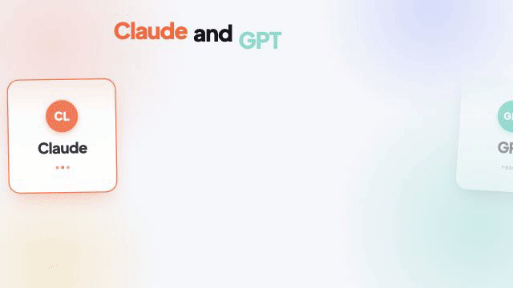

# AI Think Tank: ניסוי שנכשל

[English](README.md) · **עברית**

[לצפייה בסרטון המלא (60 שניות)](think-tank.mp4)

---

בניתי מערכת שבה GPT ו-Claude מתווכחים ביניהם כדי להגיע לתשובה טובה יותר. ואז בדקתי אם זה באמת עובד.
(ספוילר: לא.)

🎥 בסרטון: AI Think Tank. דשבורד מקומי שבו שני המודלים דנים בשאלה, מבקרים זה את זה ומגיעים לתוכנית משותפת, ואני יושב בכיסא המנחה ויכול להתערב בכל רגע. הכול רץ על המנויים הקיימים שלי, בלי מפתחות API ובלי חיוב לפי שימוש.

הרעיון: שני מודלים שונים רואים דברים שונים. אם יתקפו זה את זה, יתקנו טעויות ויסגרו פערים, התשובה המשותפת אמורה להיות טובה יותר מתשובה של מודל אחד.

איך בדקתי:
- 12 משימות בעברית: החלטות אמיתיות, בעיות חישוב עם תשובה ידועה, ומשימות "מלכודת" שמבוססות על הנחה שגויה.
- כל משימה קיבלה חמישה סוגי תשובות: תשובה ישירה של GPT, תשובה ישירה של Claude, מודל שמשפר את התשובה של עצמו, מיזוג פשוט של שתי תשובות, והדיון המלא.
- לכל התשובות אותו אורך ואותו מבנה. שני מודלים-שופטים בדקו אותן בעיוורון, לפי רשימת קריטריונים שקבעתי מראש.

מה יצא:
- ❌ הדיון לא ניצח אף פעם את הטובה מבין שתי התשובות הישירות: 0 ניצחונות, 3 תיקו ו-9 הפסדים.
- ❌ הציון הממוצע שלו היה 77%, לעומת 92% לתשובה ישירה של GPT.
- ❌ הוא דרש פי 15 קריאות למודלים ופי 9 זמן: כ-6.5 דקות, לעומת כ-40 שניות.
- ❌ הסיבה העיקרית היא סיבוך. כל מודל מוסיף הסתייגויות ומקרי קצה, והתשובה הסופית נעשית כבדה. בקריטריון "לא סיבך מעבר לנדרש" הדיון עבר ב-29% מהמשימות, והתשובה הישירה ב-96%.

מה כן עבד:
- ✅ לא היה אף כשל קריטי, והדיון זיהה את ההנחה השגויה בכל משימות המלכודת.
- ✅ כשהגיע מידע חדש ומהותי, הדיון שינה את ההחלטה. כשהגיע מידע מסיח, הוא החזיק בה.
- ✅ התשתית עצמה עובדת: דשבורד חי, מצב דיון מובנה ומערך בדיקה שאפשר להריץ שוב על כל גרסה חדשה.

השורה התחתונה: הגרסה הראשונה נכשלה. להחלטה אחת עדיף לשאול מודל אחד ישירות. ואם רוצים דעה שנייה, מיזוג פשוט של שתי תשובות נותן אותה איכות בתוך דקה.

הסרטון נגמר במשפט "You get the better answer". כתבתי אותו לפני הבדיקה.

מה לקחתי מזה: קודם מודדים, ורק אחר כך מאמינים. הדיונים נראו מרשימים, יסודיים וארוכים, ובלי הבדיקה הייתי בטוח שהמערכת עובדת. אבל להיראות חכם יותר זה לא אותו דבר כמו להיות שימושי יותר.

כרגע אני משבית את הפרויקט. אם אחזור אליו, הכיוון ברור: להוסיף שלב אחרון שמפשט את התשובה ומוחק כל מה שלא משנה את ההחלטה, ולבדוק שוב על אותן 12 משימות.

(הסתייגות: מדובר רק ב-12 משימות, ואת השיפוט עשו בעיקר מודלים. בדיקה עיוורת קצרה שעשיתי בעצמי הצביעה לאותו כיוון.)
