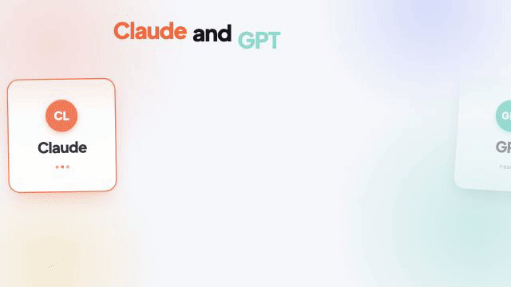

# AI Think Tank: an experiment that failed

**English** · [עברית](README.he.md)

[Watch the full video (60 seconds)](think-tank.mp4)

---

I built a system where GPT and Claude argue with each other to reach a better answer. Then I tested whether it actually works.
(Spoiler: it doesn't.)

🎥 In the video: AI Think Tank. A local dashboard where the two models discuss a question, critique each other and reach a joint plan, while I sit in the moderator's chair and can step in at any moment. It all runs on my existing subscriptions, with no API keys and no pay-per-use billing.

The idea: two different models see different things. If they challenge each other, fix each other's mistakes and close the gaps, the joint answer should be better than what a single model gives.

How I tested it:
- 12 tasks in Hebrew: real decisions, calculation problems with a known answer, and "trap" tasks built on a false assumption.
- Each task got five kinds of answers: a direct answer from GPT, a direct answer from Claude, a model improving its own answer, a simple merge of two answers, and the full debate.
- All answers had the same length and structure. Two model judges scored them blind, against a checklist I set in advance.

What came out:
- ❌ The debate never beat the better of the two direct answers: 0 wins, 3 ties, 9 losses.
- ❌ Its average score was 77%, against 92% for a direct GPT answer.
- ❌ It took 15× the model calls and 9× the time: about 6.5 minutes against about 40 seconds.
- ❌ The main reason is over-complication. Each model adds caveats and edge cases, and the final answer gets heavy. On the criterion "didn't over-complicate beyond what the case needs", the debate passed in 29% of the tasks, the direct answer in 96%.

What did work:
- ✅ Not a single critical failure, and the debate spotted the false assumption in every trap task.
- ✅ When new, material information arrived, the debate changed its decision. When distracting information arrived, it held its ground.
- ✅ The infrastructure itself works: a live dashboard, a structured debate mode, and a test setup that can be re-run on any new version.

Bottom line: the first version failed. For a single decision, you're better off asking one model directly. And if you want a second opinion, a simple merge of two answers gives the same quality within a minute.

The video ends with the line "You get the better answer". I wrote it before the test.

What I took from this: measure first, believe later. The debates looked impressive, thorough and long, and without the test I'd have been sure the system works. But looking smarter is not the same as being more useful.

For now I'm shelving the project. If I come back to it, the direction is clear: add a final step that simplifies the answer and cuts everything that doesn't change the decision, then re-test on the same 12 tasks.

(Caveat: only 12 tasks, and the judging was done mostly by models. A short blind check I did myself pointed the same way.)
